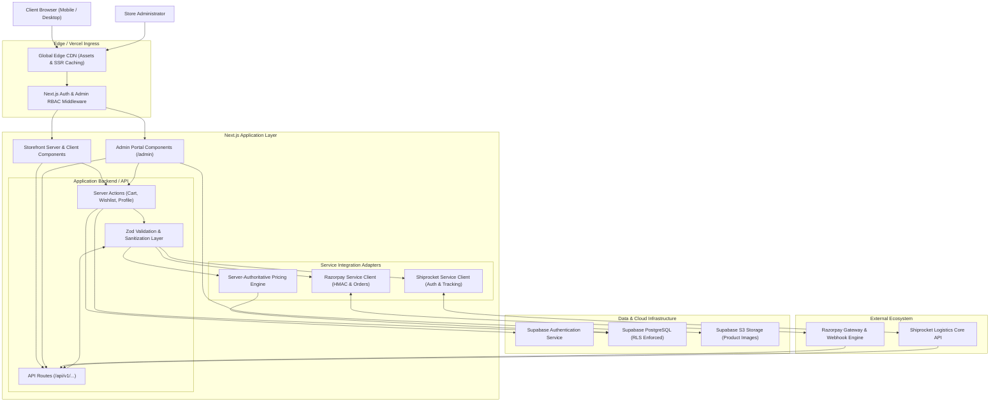
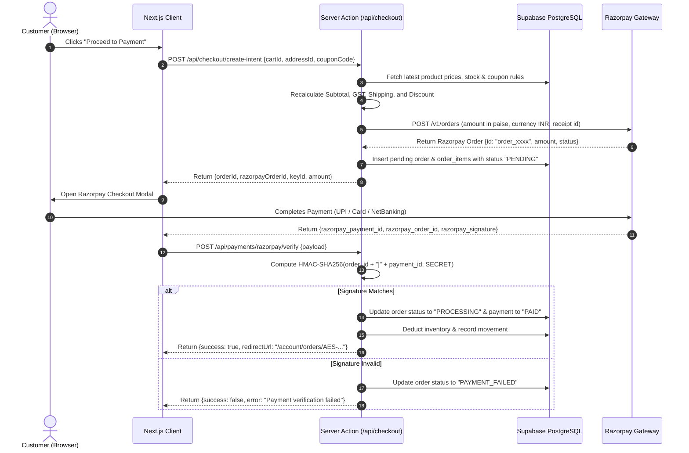

# AESTHIQUE — TECHNICAL ARCHITECTURE DOCUMENTATION

> **System:** AESTHIQUE E-Commerce Platform  
> **Architecture Pattern:** Next.js 15 Full-Stack Monorepo (App Router + Server Actions + Route Handlers)  
> **Database:** Supabase PostgreSQL with Granular RLS  
> **External Gateways:** Razorpay (Payments) & Shiprocket (Logistics)

---

## 1. High-Level System Architecture



---

## 2. Directory & Modular Structure

```
e:\AESTHIQUE
├── .planning/                  # GSD native planning documents & state
├── public/                     # Static assets, brand logo, icons
│   ├── brand/
│   │   └── aesthique-logo.png  # Official AESTHIQUE emblem
│   └── images/
├── src/
│   ├── app/                    # Next.js App Router root
│   │   ├── (storefront)/       # Customer storefront route group
│   │   │   ├── page.tsx        # Premium 12-section Homepage
│   │   │   ├── shop/           # Shop all & catalog filter
│   │   │   ├── category/[slug] # Category listing
│   │   │   ├── product/[slug]  # Rich PDP with zoom & pincode
│   │   │   ├── cart/           # Shopping Cart view
│   │   │   ├── wishlist/       # Customer Wishlist
│   │   │   ├── checkout/       # Complete single-page checkout
│   │   │   ├── account/        # Customer Profile, Addresses, Orders
│   │   │   ├── auth/           # Login, Register, Forgot Password
│   │   │   ├── about/          # Editorial brand story
│   │   │   ├── contact/        # Contact form & location details
│   │   │   ├── faq/            # Categorized FAQ accordion
│   │   │   └── policies/       # Privacy, Terms, Shipping, Returns
│   │   ├── (admin)/admin/      # Admin route group (/admin)
│   │   │   ├── login/          # Secure admin login
│   │   │   ├── dashboard/      # Overview analytics & KPIs
│   │   │   ├── products/       # Products CRUD & variants
│   │   │   ├── orders/         # Order workflow & shipments
│   │   │   ├── inventory/      # Stock control & movements
│   │   │   ├── categories/     # Category hierarchy manager
│   │   │   ├── coupons/        # Discount & promotion engine
│   │   │   ├── customers/      # Customer directory
│   │   │   ├── reviews/        # Review moderation
│   │   │   ├── banners/        # Homepage hero & promos
│   │   │   └── settings/       # Store tax & shipping settings
│   │   ├── api/                # Route handlers
│   │   │   ├── cart/           # Cart operations & recalculation
│   │   │   ├── checkout/       # Order intent & creation
│   │   │   ├── payments/
│   │   │   │   ├── razorpay/order/
│   │   │   │   ├── razorpay/verify/
│   │   │   │   └── razorpay/webhook/
│   │   │   ├── shipping/
│   │   │   │   ├── serviceability/
│   │   │   │   ├── rates/
│   │   │   │   ├── create-shipment/
│   │   │   │   └── track/
│   │   │   └── admin/          # Admin-specific API endpoints
│   │   ├── layout.tsx          # Root layout & font definitions
│   │   └── globals.css         # Tailwind base & brand typography
│   ├── components/
│   │   ├── storefront/         # Header, Footer, Hero, ProductCard, etc.
│   │   ├── admin/              # Admin navigation, tables, forms, charts
│   │   └── ui/                 # Core primitive components (Button, Modal, etc.)
│   ├── lib/
│   │   ├── supabase/           # Server, Client & Admin Supabase clients
│   │   ├── razorpay/           # Razorpay client & HMAC verification
│   │   ├── shiprocket/         # Shiprocket API integration adapter
│   │   ├── pricing/            # Server-authoritative calculation engine
│   │   ├── validators/         # Zod schemas for all domain entities
│   │   └── utils/              # Formatting, currency, date helpers
│   └── types/                  # TypeScript interface definitions
├── supabase/
│   └── migrations/             # SQL migration files
├── .env.example                # Standard environment configuration template
├── package.json
├── tsconfig.json
└── tailwind.config.ts
```

---

## 3. Server vs. Client Boundary Strategy

| Module | Boundary Type | Purpose & Security Rationale |
| :--- | :--- | :--- |
| **Catalog Browsing & PDP** | Server Component (`RSC`) | Fast initial load, full SEO rendering, server-side caching of static catalog data. |
| **Search & Filter Controls** | Client Component (`'use client'`) | Debounced keystrokes, URL parameter syncing, dynamic category chips. |
| **Cart & Pricing Engine** | Server Actions / API Routes | Prevents client price tampering; all calculation logic runs in isolated Node.js environment. |
| **Checkout Flow** | Client Form + Server Action | Fluid client validation and Razorpay SDK modal mount, backed by atomic server order creation. |
| **Payment Verification** | Pure Server API Route | Direct HMAC-SHA256 signature calculation using server-only `RAZORPAY_KEY_SECRET`. |
| **Admin Dashboard** | Hybrid RSC + Client Forms | Protected server layout verifying `admin_users` table; interactive data tables and modals. |

---

## 4. Payment & Order Creation Sequence (Razorpay)



---

## 5. Shipping & Fulfillment Workflow (Shiprocket)

1. **Serviceability Check:** Customer or admin enters 6-digit Indian PIN code. System calls Shiprocket `GET /open/courier/serviceability/` to retrieve available couriers, expected delivery days, and estimated freight rate.
2. **Order Placement:** Order placed in system with shipping snapshot (`user_addresses`).
3. **Admin Triggered Shipment:** Admin clicks "Create Shipment" in `/admin/orders/[id]`:
   - System formats Shiprocket custom order payload (SKU, quantity, package dimensions `l x b x h`, dead weight in kg).
   - System calls Shiprocket `POST /v1/external/orders/create/adhoc`.
   - Shiprocket returns `order_id` and `shipment_id`.
4. **AWB Assignment:** Admin triggers "Generate AWB". System requests `POST /v1/external/courier/assign/awb` to allocate courier and assign tracking AWB number.
5. **Pickup & Label:** System requests `POST /v1/external/courier/generate/label` and downloads label URL.
6. **Real-time Tracking Synchronization:** System registers Shiprocket webhook or runs background sync against `GET /v1/external/courier/track/awb/:awb_code`.
