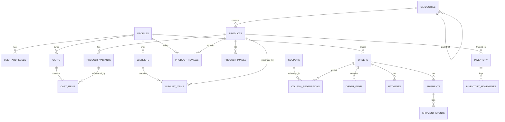

# AESTHIQUE — DATABASE SCHEMA SPECIFICATION

> **Database Engine:** PostgreSQL 15+ (Supabase)  
> **Security Model:** Row Level Security (RLS) enabled on all tables  
> **Integrity:** Foreign Key Constraints with CASCADE/RESTRICT rules, Timestamps with auto-update triggers  
> **Table Count:** 24 Reconciled Relational Tables (Reconciled from preliminary 22-table draft)

---

## 1. Schema Diagram & Table Relationships



---

## 2. Table Definitions

### 2.1 Identity & Customer Management

#### `profiles`
Extends `auth.users` for customer identity.
```sql
CREATE TABLE public.profiles (
    id UUID PRIMARY KEY REFERENCES auth.users(id) ON DELETE CASCADE,
    email TEXT UNIQUE NOT NULL,
    first_name TEXT,
    last_name TEXT,
    phone TEXT,
    avatar_url TEXT,
    created_at TIMESTAMPTZ DEFAULT NOW() NOT NULL,
    updated_at TIMESTAMPTZ DEFAULT NOW() NOT NULL
);
```

#### `admin_users`
Strict role-based administrator access table.
```sql
CREATE TABLE public.admin_users (
    id UUID PRIMARY KEY REFERENCES auth.users(id) ON DELETE CASCADE,
    email TEXT UNIQUE NOT NULL,
    role TEXT NOT NULL CHECK (role IN ('super_admin', 'manager', 'support')),
    is_active BOOLEAN DEFAULT TRUE NOT NULL,
    created_at TIMESTAMPTZ DEFAULT NOW() NOT NULL,
    updated_at TIMESTAMPTZ DEFAULT NOW() NOT NULL
);
```

#### `user_addresses`
Saved customer shipping and billing addresses.
```sql
CREATE TABLE public.user_addresses (
    id UUID PRIMARY KEY DEFAULT gen_random_uuid(),
    user_id UUID REFERENCES public.profiles(id) ON DELETE CASCADE NOT NULL,
    full_name TEXT NOT NULL,
    mobile TEXT NOT NULL,
    email TEXT,
    house_number TEXT NOT NULL,
    street TEXT NOT NULL,
    area TEXT,
    landmark TEXT,
    city TEXT NOT NULL,
    state TEXT NOT NULL,
    pincode VARCHAR(10) NOT NULL,
    address_type TEXT DEFAULT 'home' CHECK (address_type IN ('home', 'office', 'other')),
    is_default_shipping BOOLEAN DEFAULT FALSE NOT NULL,
    is_default_billing BOOLEAN DEFAULT FALSE NOT NULL,
    created_at TIMESTAMPTZ DEFAULT NOW() NOT NULL,
    updated_at TIMESTAMPTZ DEFAULT NOW() NOT NULL
);
CREATE INDEX idx_user_addresses_user_id ON public.user_addresses(user_id);
```

---

### 2.2 Catalog & Product Management

#### `categories`
Hierarchical product taxonomy.
```sql
CREATE TABLE public.categories (
    id UUID PRIMARY KEY DEFAULT gen_random_uuid(),
    parent_id UUID REFERENCES public.categories(id) ON DELETE SET NULL,
    name TEXT NOT NULL,
    slug TEXT UNIQUE NOT NULL,
    description TEXT,
    image_url TEXT,
    display_order INT DEFAULT 0 NOT NULL,
    is_active BOOLEAN DEFAULT TRUE NOT NULL,
    created_at TIMESTAMPTZ DEFAULT NOW() NOT NULL,
    updated_at TIMESTAMPTZ DEFAULT NOW() NOT NULL
);
CREATE INDEX idx_categories_slug ON public.categories(slug);
```

#### `products`
Core product catalog table.
```sql
CREATE TABLE public.products (
    id UUID PRIMARY KEY DEFAULT gen_random_uuid(),
    category_id UUID REFERENCES public.categories(id) ON DELETE RESTRICT NOT NULL,
    name TEXT NOT NULL,
    slug TEXT UNIQUE NOT NULL,
    sku TEXT UNIQUE NOT NULL,
    short_description TEXT,
    full_description TEXT,
    regular_price NUMERIC(10,2) NOT NULL CHECK (regular_price >= 0),
    sale_price NUMERIC(10,2) CHECK (sale_price >= 0 AND sale_price <= regular_price),
    weight_in_grams INT DEFAULT 500 NOT NULL,
    dimensions_cm JSONB DEFAULT '{"length": 10, "breadth": 10, "height": 10}'::JSONB,
    specifications JSONB DEFAULT '[]'::JSONB,
    care_instructions TEXT,
    is_featured BOOLEAN DEFAULT FALSE NOT NULL,
    is_bestseller BOOLEAN DEFAULT FALSE NOT NULL,
    is_new_arrival BOOLEAN DEFAULT FALSE NOT NULL,
    is_active BOOLEAN DEFAULT TRUE NOT NULL,
    seo_title TEXT,
    seo_description TEXT,
    seo_keywords TEXT[],
    created_at TIMESTAMPTZ DEFAULT NOW() NOT NULL,
    updated_at TIMESTAMPTZ DEFAULT NOW() NOT NULL
);
CREATE INDEX idx_products_category ON public.products(category_id);
CREATE INDEX idx_products_slug ON public.products(slug);
CREATE INDEX idx_products_status ON public.products(is_active, is_featured, is_bestseller);
```

#### `product_images`
Multiple high-res lifestyle product images.
```sql
CREATE TABLE public.product_images (
    id UUID PRIMARY KEY DEFAULT gen_random_uuid(),
    product_id UUID REFERENCES public.products(id) ON DELETE CASCADE NOT NULL,
    image_url TEXT NOT NULL,
    alt_text TEXT,
    display_order INT DEFAULT 0 NOT NULL,
    is_primary BOOLEAN DEFAULT FALSE NOT NULL,
    created_at TIMESTAMPTZ DEFAULT NOW() NOT NULL
);
CREATE INDEX idx_product_images_product ON public.product_images(product_id);
```

#### `product_variants`
SKU-level variants (size, color, finish).
```sql
CREATE TABLE public.product_variants (
    id UUID PRIMARY KEY DEFAULT gen_random_uuid(),
    product_id UUID REFERENCES public.products(id) ON DELETE CASCADE NOT NULL,
    sku TEXT UNIQUE NOT NULL,
    name TEXT NOT NULL,
    variant_type TEXT NOT NULL, -- e.g. "Color", "Size"
    variant_value TEXT NOT NULL, -- e.g. "Ivory Cream", "Large"
    price_adjustment NUMERIC(10,2) DEFAULT 0.00 NOT NULL,
    image_url TEXT,
    is_active BOOLEAN DEFAULT TRUE NOT NULL,
    created_at TIMESTAMPTZ DEFAULT NOW() NOT NULL,
    updated_at TIMESTAMPTZ DEFAULT NOW() NOT NULL
);
CREATE INDEX idx_product_variants_product ON public.product_variants(product_id);
```

#### `inventory`
Stock levels for products and variants.
```sql
CREATE TABLE public.inventory (
    id UUID PRIMARY KEY DEFAULT gen_random_uuid(),
    product_id UUID REFERENCES public.products(id) ON DELETE CASCADE NOT NULL,
    variant_id UUID REFERENCES public.product_variants(id) ON DELETE CASCADE,
    stock_quantity INT DEFAULT 0 NOT NULL CHECK (stock_quantity >= 0),
    reserved_quantity INT DEFAULT 0 NOT NULL CHECK (reserved_quantity >= 0),
    low_stock_threshold INT DEFAULT 5 NOT NULL,
    created_at TIMESTAMPTZ DEFAULT NOW() NOT NULL,
    updated_at TIMESTAMPTZ DEFAULT NOW() NOT NULL,
    CONSTRAINT uq_product_variant UNIQUE (product_id, variant_id)
);
```

#### `inventory_movements`
Audit log of stock additions, orders, adjustments, and returns.
```sql
CREATE TABLE public.inventory_movements (
    id UUID PRIMARY KEY DEFAULT gen_random_uuid(),
    inventory_id UUID REFERENCES public.inventory(id) ON DELETE CASCADE NOT NULL,
    change_quantity INT NOT NULL,
    action_type TEXT NOT NULL CHECK (action_type IN ('order_reservation', 'order_fulfillment', 'order_cancelled', 'manual_adjustment', 'restock')),
    reference_id TEXT, -- e.g. order_id
    reason TEXT,
    created_at TIMESTAMPTZ DEFAULT NOW() NOT NULL
);
```

---

### 2.3 Cart & Wishlist

#### `carts` & `cart_items`
```sql
CREATE TABLE public.carts (
    id UUID PRIMARY KEY DEFAULT gen_random_uuid(),
    user_id UUID REFERENCES public.profiles(id) ON DELETE CASCADE,
    session_token TEXT, -- For guest carts
    created_at TIMESTAMPTZ DEFAULT NOW() NOT NULL,
    updated_at TIMESTAMPTZ DEFAULT NOW() NOT NULL
);

CREATE TABLE public.cart_items (
    id UUID PRIMARY KEY DEFAULT gen_random_uuid(),
    cart_id UUID REFERENCES public.carts(id) ON DELETE CASCADE NOT NULL,
    product_id UUID REFERENCES public.products(id) ON DELETE CASCADE NOT NULL,
    variant_id UUID REFERENCES public.product_variants(id) ON DELETE SET NULL,
    quantity INT NOT NULL CHECK (quantity > 0),
    created_at TIMESTAMPTZ DEFAULT NOW() NOT NULL,
    updated_at TIMESTAMPTZ DEFAULT NOW() NOT NULL,
    CONSTRAINT uq_cart_item UNIQUE (cart_id, product_id, variant_id)
);
```

#### `wishlists` & `wishlist_items`
```sql
CREATE TABLE public.wishlists (
    id UUID PRIMARY KEY DEFAULT gen_random_uuid(),
    user_id UUID REFERENCES public.profiles(id) ON DELETE CASCADE UNIQUE NOT NULL,
    created_at TIMESTAMPTZ DEFAULT NOW() NOT NULL
);

CREATE TABLE public.wishlist_items (
    id UUID PRIMARY KEY DEFAULT gen_random_uuid(),
    wishlist_id UUID REFERENCES public.wishlists(id) ON DELETE CASCADE NOT NULL,
    product_id UUID REFERENCES public.products(id) ON DELETE CASCADE NOT NULL,
    created_at TIMESTAMPTZ DEFAULT NOW() NOT NULL,
    CONSTRAINT uq_wishlist_product UNIQUE (wishlist_id, product_id)
);
```

---

### 2.4 Coupons & Promotions

#### `coupons` & `coupon_redemptions`
```sql
CREATE TABLE public.coupons (
    id UUID PRIMARY KEY DEFAULT gen_random_uuid(),
    code TEXT UNIQUE NOT NULL,
    discount_type TEXT NOT NULL CHECK (discount_type IN ('percentage', 'fixed')),
    discount_value NUMERIC(10,2) NOT NULL CHECK (discount_value > 0),
    min_order_value NUMERIC(10,2) DEFAULT 0.00 NOT NULL,
    max_discount_amount NUMERIC(10,2),
    usage_limit INT,
    times_used INT DEFAULT 0 NOT NULL,
    is_active BOOLEAN DEFAULT TRUE NOT NULL,
    starts_at TIMESTAMPTZ DEFAULT NOW() NOT NULL,
    expires_at TIMESTAMPTZ,
    created_at TIMESTAMPTZ DEFAULT NOW() NOT NULL,
    updated_at TIMESTAMPTZ DEFAULT NOW() NOT NULL
);

CREATE TABLE public.coupon_redemptions (
    id UUID PRIMARY KEY DEFAULT gen_random_uuid(),
    coupon_id UUID REFERENCES public.coupons(id) ON DELETE RESTRICT NOT NULL,
    user_id UUID REFERENCES public.profiles(id) ON DELETE SET NULL,
    order_id UUID NOT NULL, -- references orders(id)
    discount_applied NUMERIC(10,2) NOT NULL,
    created_at TIMESTAMPTZ DEFAULT NOW() NOT NULL
);
```

---

### 2.5 Orders & Fulfillment

#### `orders`
```sql
CREATE TABLE public.orders (
    id UUID PRIMARY KEY DEFAULT gen_random_uuid(),
    order_number TEXT UNIQUE NOT NULL,
    user_id UUID REFERENCES public.profiles(id) ON DELETE SET NULL,
    customer_email TEXT NOT NULL,
    customer_phone TEXT NOT NULL,
    status TEXT NOT NULL DEFAULT 'PENDING' CHECK (status IN (
        'PENDING', 'PROCESSING', 'SHIPPED', 'OUT_FOR_DELIVERY', 'DELIVERED', 'CANCELLED', 'REFUNDED'
    )),
    payment_status TEXT NOT NULL DEFAULT 'UNPAID' CHECK (payment_status IN (
        'UNPAID', 'AUTHORIZED', 'PAID', 'FAILED', 'REFUNDED', 'PARTIALLY_REFUNDED'
    )),
    fulfillment_status TEXT NOT NULL DEFAULT 'UNFULFILLED' CHECK (fulfillment_status IN (
        'UNFULFILLED', 'PROCESSING', 'FULFILLED', 'CANCELLED'
    )),
    currency VARCHAR(3) DEFAULT 'INR' NOT NULL,
    subtotal_amount NUMERIC(10,2) NOT NULL,
    discount_amount NUMERIC(10,2) DEFAULT 0.00 NOT NULL,
    tax_amount NUMERIC(10,2) DEFAULT 0.00 NOT NULL,
    shipping_fee NUMERIC(10,2) DEFAULT 0.00 NOT NULL,
    total_amount NUMERIC(10,2) NOT NULL,
    shipping_address_snapshot JSONB NOT NULL,
    billing_address_snapshot JSONB NOT NULL,
    notes TEXT,
    created_at TIMESTAMPTZ DEFAULT NOW() NOT NULL,
    updated_at TIMESTAMPTZ DEFAULT NOW() NOT NULL
);
CREATE INDEX idx_orders_user ON public.orders(user_id);
CREATE INDEX idx_orders_number ON public.orders(order_number);
CREATE INDEX idx_orders_status ON public.orders(status, payment_status);
```

#### `order_items`
```sql
CREATE TABLE public.order_items (
    id UUID PRIMARY KEY DEFAULT gen_random_uuid(),
    order_id UUID REFERENCES public.orders(id) ON DELETE CASCADE NOT NULL,
    product_id UUID REFERENCES public.products(id) ON DELETE RESTRICT NOT NULL,
    variant_id UUID REFERENCES public.product_variants(id) ON DELETE SET NULL,
    product_name TEXT NOT NULL,
    variant_name TEXT,
    sku TEXT NOT NULL,
    unit_price NUMERIC(10,2) NOT NULL,
    quantity INT NOT NULL CHECK (quantity > 0),
    total_price NUMERIC(10,2) NOT NULL,
    image_url TEXT,
    created_at TIMESTAMPTZ DEFAULT NOW() NOT NULL
);
CREATE INDEX idx_order_items_order ON public.order_items(order_id);
```

---

### 2.6 Payments & Shipments

#### `payments`
```sql
CREATE TABLE public.payments (
    id UUID PRIMARY KEY DEFAULT gen_random_uuid(),
    order_id UUID REFERENCES public.orders(id) ON DELETE CASCADE NOT NULL,
    payment_method TEXT NOT NULL CHECK (payment_method IN ('RAZORPAY', 'COD')),
    gateway_order_id TEXT, -- Razorpay order_id
    gateway_payment_id TEXT, -- Razorpay payment_id
    gateway_signature TEXT,
    amount NUMERIC(10,2) NOT NULL,
    currency VARCHAR(3) DEFAULT 'INR' NOT NULL,
    status TEXT NOT NULL CHECK (status IN ('PENDING', 'SUCCESS', 'FAILED', 'REFUNDED')),
    gateway_response JSONB,
    created_at TIMESTAMPTZ DEFAULT NOW() NOT NULL,
    updated_at TIMESTAMPTZ DEFAULT NOW() NOT NULL
);
CREATE INDEX idx_payments_order ON public.payments(order_id);
CREATE INDEX idx_payments_gateway_order ON public.payments(gateway_order_id);
```

#### `shipments` & `shipment_events`
```sql
CREATE TABLE public.shipments (
    id UUID PRIMARY KEY DEFAULT gen_random_uuid(),
    order_id UUID REFERENCES public.orders(id) ON DELETE CASCADE NOT NULL,
    shiprocket_order_id TEXT,
    shiprocket_shipment_id TEXT,
    courier_name TEXT,
    awb_code TEXT UNIQUE,
    label_url TEXT,
    manifest_url TEXT,
    status TEXT DEFAULT 'PROCESSING' NOT NULL,
    pickup_scheduled_date TIMESTAMPTZ,
    estimated_delivery_date TIMESTAMPTZ,
    delivered_date TIMESTAMPTZ,
    created_at TIMESTAMPTZ DEFAULT NOW() NOT NULL,
    updated_at TIMESTAMPTZ DEFAULT NOW() NOT NULL
);

CREATE TABLE public.shipment_events (
    id UUID PRIMARY KEY DEFAULT gen_random_uuid(),
    shipment_id UUID REFERENCES public.shipments(id) ON DELETE CASCADE NOT NULL,
    status TEXT NOT NULL,
    location TEXT,
    event_timestamp TIMESTAMPTZ NOT NULL,
    description TEXT,
    created_at TIMESTAMPTZ DEFAULT NOW() NOT NULL
);
```

---

### 2.7 Reviews, Settings & Marketing

#### `product_reviews`
```sql
CREATE TABLE public.product_reviews (
    id UUID PRIMARY KEY DEFAULT gen_random_uuid(),
    product_id UUID REFERENCES public.products(id) ON DELETE CASCADE NOT NULL,
    user_id UUID REFERENCES public.profiles(id) ON DELETE SET NULL,
    author_name TEXT NOT NULL,
    rating INT NOT NULL CHECK (rating >= 1 AND rating <= 5),
    headline TEXT,
    review_text TEXT NOT NULL,
    is_verified_purchase BOOLEAN DEFAULT FALSE NOT NULL,
    is_approved BOOLEAN DEFAULT FALSE NOT NULL,
    created_at TIMESTAMPTZ DEFAULT NOW() NOT NULL,
    updated_at TIMESTAMPTZ DEFAULT NOW() NOT NULL
);
```

#### `newsletter_subscribers`, `store_settings`, `homepage_banners`
```sql
CREATE TABLE public.newsletter_subscribers (
    id UUID PRIMARY KEY DEFAULT gen_random_uuid(),
    email TEXT UNIQUE NOT NULL,
    is_active BOOLEAN DEFAULT TRUE NOT NULL,
    created_at TIMESTAMPTZ DEFAULT NOW() NOT NULL
);

CREATE TABLE public.store_settings (
    key TEXT PRIMARY KEY,
    value JSONB NOT NULL,
    description TEXT,
    updated_at TIMESTAMPTZ DEFAULT NOW() NOT NULL
);

CREATE TABLE public.homepage_banners (
    id UUID PRIMARY KEY DEFAULT gen_random_uuid(),
    banner_type TEXT NOT NULL CHECK (banner_type IN ('hero', 'promo', 'announcement')),
    title TEXT NOT NULL,
    subtitle TEXT,
    image_url TEXT,
    link_url TEXT,
    button_text TEXT,
    display_order INT DEFAULT 0 NOT NULL,
    is_active BOOLEAN DEFAULT TRUE NOT NULL,
    created_at TIMESTAMPTZ DEFAULT NOW() NOT NULL,
    updated_at TIMESTAMPTZ DEFAULT NOW() NOT NULL
);
```

---

## 3. Row Level Security (RLS) Policies Summary

1. **`profiles`:**
   - `SELECT`: `auth.uid() = id` OR `EXISTS (SELECT 1 FROM admin_users WHERE id = auth.uid())`
   - `UPDATE`: `auth.uid() = id`
2. **`user_addresses`:**
   - `ALL`: `auth.uid() = user_id` OR admin.
3. **`products`, `categories`, `product_images`, `product_variants`:**
   - `SELECT`: Public access where `is_active = true`. Admins can select all.
   - `INSERT / UPDATE / DELETE`: Only verified `admin_users`.
4. **`orders`, `order_items`, `payments`, `shipments`:**
   - `SELECT`: `auth.uid() = user_id` OR admin.
   - `INSERT / UPDATE`: Server-side service role execution for order placement and webhook updates.
5. **`admin_users`:**
   - `SELECT`: Only authenticated users with matching record in `admin_users`.
   - `INSERT / UPDATE / DELETE`: Super admin only.
